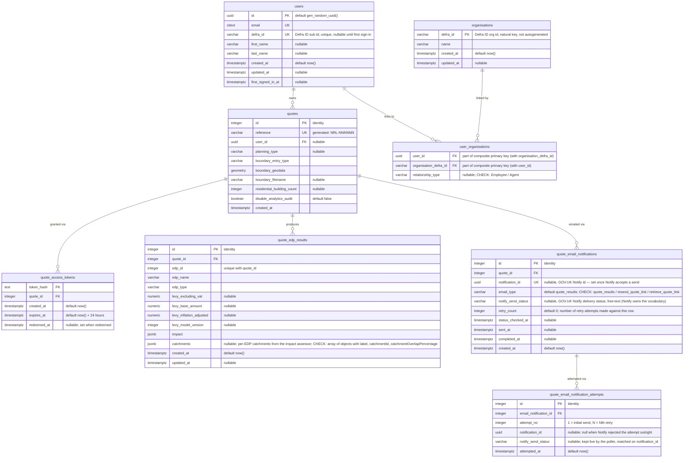

# Quote database ERD

Entity-relationship diagram of the backend **`nrf_backend`** Postgres database
(schema `public`) — the quote domain.

- **Source:** live `nrf_backend` Postgres instance (`docker compose` service `postgres`), cross-checked against the Liquibase changelog under `backend/changelog/`.
- **Generated:** 2026-09-08

- **Scope:** application domain tables only. Liquibase bookkeeping (`databasechangelog`, `databasechangeloglock`) and the PostGIS reference table (`spatial_ref_sys`) are excluded.

## Tables

| Table                               | Purpose                                                                                                                                                                                                                                                                                                                                                                                                            |
| ----------------------------------- | ------------------------------------------------------------------------------------------------------------------------------------------------------------------------------------------------------------------------------------------------------------------------------------------------------------------------------------------------------------------------------------------------------------------ |
| `users`                             | Account holders, keyed by UUID and unique (case-insensitive) email; Defra ID profile details captured at sign-in.                                                                                                                                                                                                                                                                                                  |
| `organisations`                     | Organisations as identified by Defra ID, keyed by the (natural) `defra_id`.                                                                                                                                                                                                                                                                                                                                        |
| `user_organisations`                | Join table linking users to organisations with a relationship type (employee / agent). Citizens have no organisation link.                                                                                                                                                                                                                                                                                         |
| `quotes`                            | Core quote records: development boundary, type, counts, and the spatial boundary geometry. Optionally linked to a `user`.                                                                                                                                                                                                                                                                                          |
| `quote_access_tokens`               | Hashed single-use access tokens granting time-limited access to a quote.                                                                                                                                                                                                                                                                                                                                           |
| `quote_edp_results`                 | Per-EDP levy results computed for a quote (unique per `quote_id` + `edp_id`).                                                                                                                                                                                                                                                                                                                                      |
| `quote_email_notifications`         | One row per quote email lifecycle, keyed by `email_type`: `quote_results` (impact assessor delivers levy results), `resend_quote_link` (applicant requests a new access link) or `retrieve_quote_link` (applicant asks for a magic link to retrieve a saved quote). Holds the current Notify id and polled delivery status; retries update the row in place and bump `retry_count` rather than inserting new rows. |
| `quote_email_notification_attempts` | One row per send attempt (the initial send plus each retry) for every email lifecycle and type, so the admin frontend can show each retry attempt and its outcome. The poller keeps attempt statuses live, matched on `notification_id`. Lifecycle rows created before this table existed have no attempt history.                                                                                                 |

## Notes

- `quotes.reference` is a generated column (`NRL-` + a hashed, zero-padded id) defined via raw SQL in the Liquibase changelog.
- `quote_access_tokens`, `quote_edp_results` and `quote_email_notifications` foreign keys to `quotes` are `ON DELETE CASCADE`, as is `quote_email_notification_attempts`' foreign key to `quote_email_notifications`.
- `user_organisations` rows cascade-delete when their parent `users.id` or `organisations.defra_id` row is deleted.
- `user_organisations.user_id + organisation_defra_id` form the composite primary key — one row per user/organisation pair. `relationship_type` is nullable and restricted by a CHECK constraint to Employee / Agent (NULL passes the check) — a Citizen never gets a row here.
- `users.defra_id` is unique but nullable — users created before signing in have no Defra ID yet (Postgres allows multiple NULLs under a unique constraint).
- `quotes.user_id` is nullable — a quote can exist without an associated user.
- A quote has zero `quote_email_notifications` rows before its first send, one after the initial `quote_results`, and one more per user-initiated resend or magic-link request. Retries do **not** create new rows — they update the existing row in place. So the one-to-many is bounded in practice by "1 + number of resends and magic-link requests," not "1 + number of send attempts."
- `quote_email_notifications.email_type` is constrained by a CHECK to `quote_results` (impact assessor delivered results), `resend_quote_link` (applicant requested a new access link) and `retrieve_quote_link` (applicant asked for a magic link to retrieve a saved quote). Each such row represents one email lifecycle — the retry worker updates the row in place, overwriting `notification_id` with the fresh id Notify returns and resetting `notify_send_status` / `sent_at` / `completed_at` so the poller repopulates them; `retry_count` is bumped on every attempt, including ones Notify rejects at accept time (those leave `notification_id` unchanged). The retry worker re-sends the quote email types (`quote_results`, `resend_quote_link`) with the quote results template and `retrieve_quote_link` rows with the retrieve template — a retrieve retry issues a fresh single-use access token (the emailed raw token is unrecoverable, only its hash is stored), expiring any live token exactly like a user-initiated re-request. Superseding is scoped per kind: a quote email is only superseded by a newer quote email, a retrieve link only by a newer retrieve link. The status poller covers every type.
- `quote_email_notifications.notification_id` is nullable and unique: it stays null until Notify accepts a send, then holds the current Notify id for the lifecycle. The poller skips rows where it is still null (a retry Notify rejected at accept time on a fresh lifecycle).
- `quote_email_notifications.notify_send_status` is deliberately free-text: it mirrors a GOV.UK Notify delivery status, whose vocabulary Notify owns, so pinning it to a CHECK would break us the day Notify adds a new value. It is null until the Notify status poller first fetches it. See [GOV.UK Notify email status descriptions](https://docs.notifications.service.gov.uk/node.html#email-status-descriptions) for the values Notify currently returns.
- `quote_email_notification_attempts` reverses NRF2-849's "per-attempt history moves to app logs" trade-off: one row is appended per send attempt (initial + retries) for admin observability. When a row is selected for retry its previous attempt's status is already terminal, so appended history is truthful; the poller then keeps the newest accepted attempt's status live by matching on `notification_id`. `notification_id` carries no unique constraint because rejected attempts hold NULL.
- `quote_edp_results` levy columns (`levy_excluding_vat`, `levy_base_amount`, `levy_inflation_adjusted`) are `NUMERIC(12,2)`; `levy_model_version` is `INTEGER`. All four are nullable — they are populated when the impact assessor reports results.
- `quote_edp_results.catchments` is a jsonb array of `{ label: string, catchmentId: string | null, catchmentOverlapPercentage: number 0-100 }`, recorded as-is from the impact assessor callback. The `ck_quote_edp_results_catchments` CHECK constraint enforces that shape (NULL passes — the column is optional while the assessor rolls out) but permits extra keys, so the assessor can add fields without a migration.
- This is the backend quote database, not the impact-assessor DB (`nrf_impact`, schema `public`).
